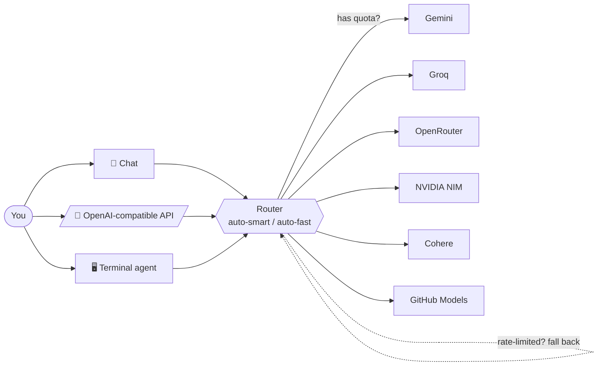

<div align="center">


<h1>FreeToken</h1>

<a href="https://readme-typing-svg.demolab.com">
  
</a>

<p><strong>Connect the free tiers you already have — Gemini, Groq, OpenRouter, NVIDIA, Cohere and more —<br/>and use them as a single pool through one chat, one OpenAI-compatible API, and one agentic terminal.</strong></p>


</div>

---

## ✨ Why FreeToken?

Every AI provider hands out a free tier. On their own, each runs out fast. **FreeToken pools them.** You connect the free API keys you already have, and every request is routed to whichever provider still has quota — falling back automatically the moment one is rate-limited. Keys are encrypted and only ever used for *your* requests. No pooling with anyone else, no card, no cost.

```
  Gemini ┐
  Groq   ┤
  NVIDIA ┼──►  FreeToken router  ──►  Chat · API · Terminal
  Cohere ┤      (auto-failover)
  GitHub ┘
```

## 🧭 How it works



## 🚀 Features

| | |
|---|---|
| 🔀 **Smart routing** | Each request goes to a provider with free quota; instant fallback on rate-limits. |
| 💬 **Unified chat** | Markdown, images, voice in/out, attachments — across all your providers. |
| 🔌 **Your own API** | A personal OpenAI-compatible endpoint (`/api/v1`) — point any tool at your pool. |
| 🖥️ **Agentic terminal** | A coding agent like Claude Code: runs commands, edits files, starts servers — you approve each step. |
| 🎨 **Image studio** | Keyless image generation (Flux / Turbo) + optional Gemini engine. |
| 📄 **Chat with docs** | Upload text, PDFs, or **images (OCR)** and ask questions with citations (RAG). |
| 🌐 **Web search** | Keyless URL reader + Tavily search, usable in chat and the terminal. |
| 🛠️ **Tools** | Extract · translate (DeepL-powered) · summarize · classify. |
| 📊 **Usage dashboard** | See exactly how much free quota you have left, per provider. |

## 🖥️ The terminal agent

```bash
$ freetoken --project my-app

  ◆ FreeToken Agent
  I can run commands & edit files — you approve each.  /chat · /help

› build me a landing page and run it

⏺ Write(index.html)
  ⎿  Created index.html (+24 -0)
⏺ Serve(node server.js)
  ⎿  Started on http://localhost:5173 (PORT=5173)
  ↳ groq/openai/gpt-oss-120b · 1,189 tok
```

- **Real tools:** `run_command`, `read/write/edit_file`, `grep`, `glob`, `read_url`, `search_web`, `image_gen`, `start_server` (auto free-port).
- **You stay in control:** read-only tools run automatically; anything that changes files or runs commands asks first — `[y]es · [a]lways · [e]dit · [n]o`.
- **Feels right:** streaming answers, colored diffs before writes, syntax highlighting, a thinking spinner, `Ctrl-C` to interrupt, multi-line input, `@file` mentions, tab-completion, and `/plan` mode.

## ⚡ Quickstart

```bash
# 1. Install
git clone <your-fork-url> freetoken && cd freetoken
npm install

# 2. Configure
cp .env.example .env.local
#   then set AUTH_SECRET and VAULT_MASTER_KEY (see .env.example)

# 3. Database (embedded Postgres — no server to run)
npm run db:migrate
npm run db:seed

# 4. Go
npm run dev        # http://localhost:3000
```

Then open **/connect**, add a free key or two, and start chatting.

### Use the terminal agent

```bash
npm link                 # exposes the `freetoken` command
freetoken login          # paste an ft_ token from the web app's API page
freetoken                # interactive agent in the current folder
freetoken --yolo "..."   # one-shot, auto-approving every step
```

## 🔑 What you can connect

**Chat providers** — all free, most need no card:

| Provider | Free tier |
|---|---|
| Google Gemini · Groq · NVIDIA NIM · Cohere · GitHub Models | free, no card |
| OpenRouter | `:free` models |

**Tools & services** (optional, each unlocks a capability):

| Service | Powers |
|---|---|
| Tavily | web search |
| DeepL | higher-quality translation |
| Jina | document embeddings |
| OCR.space | reading scanned files |
| ElevenLabs · Google Cloud TTS | premium read-aloud voices |

## 🧱 Tech stack

Next.js 16 (App Router) · React 19 · TypeScript · Drizzle ORM · PGlite (embedded Postgres) · Auth.js v5 · Tailwind v4 · Vitest.

## 🤝 Contributing

Issues and PRs welcome. Run `npm test` (222 tests), `npm run lint`, and `npx tsc --noEmit` before opening a PR.

## 📄 License

MIT — see [LICENSE](LICENSE). Use it, fork it, share it.

<div align="center"><sub>Built to make the free tier go further.</sub></div>
