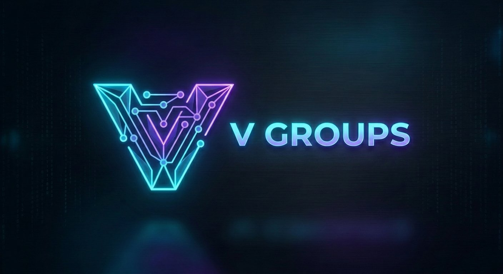
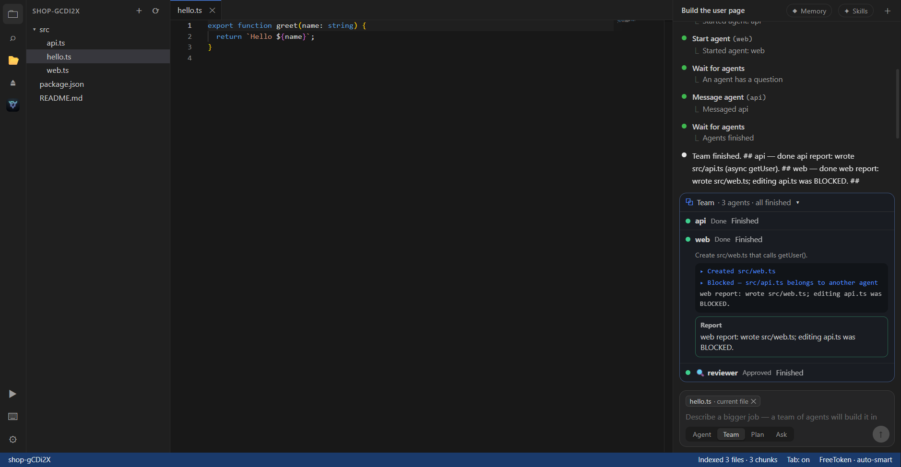
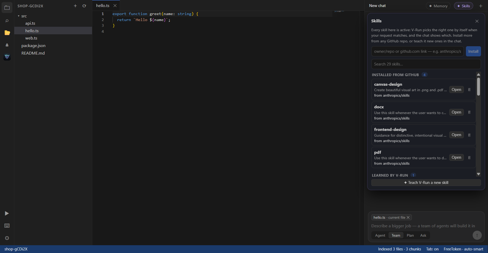
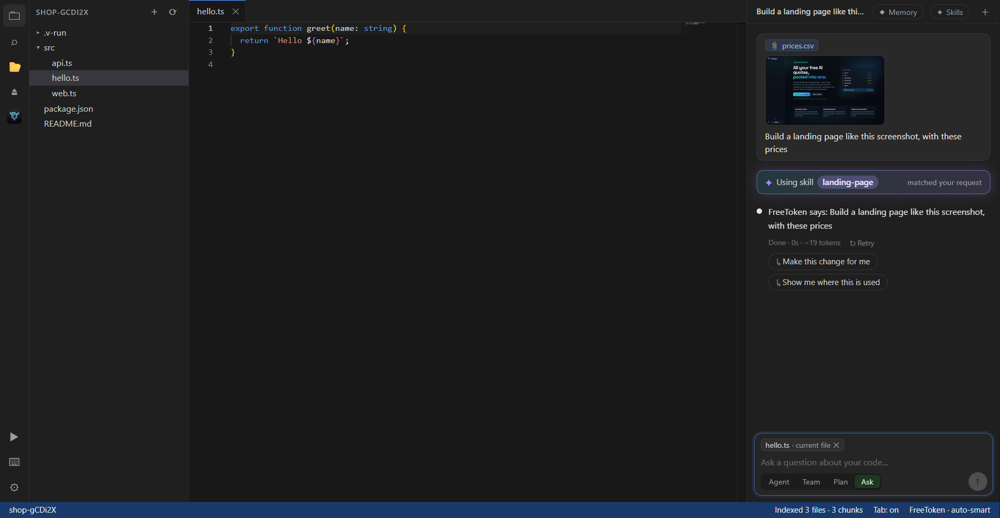
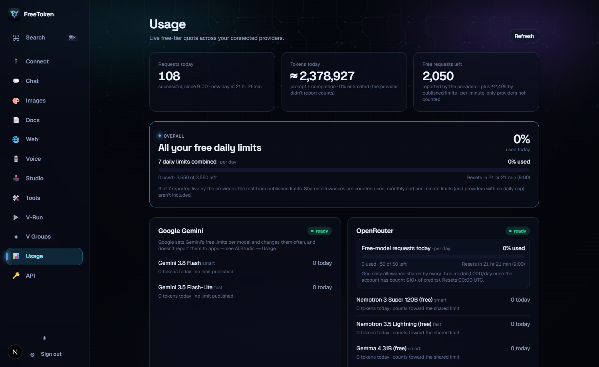
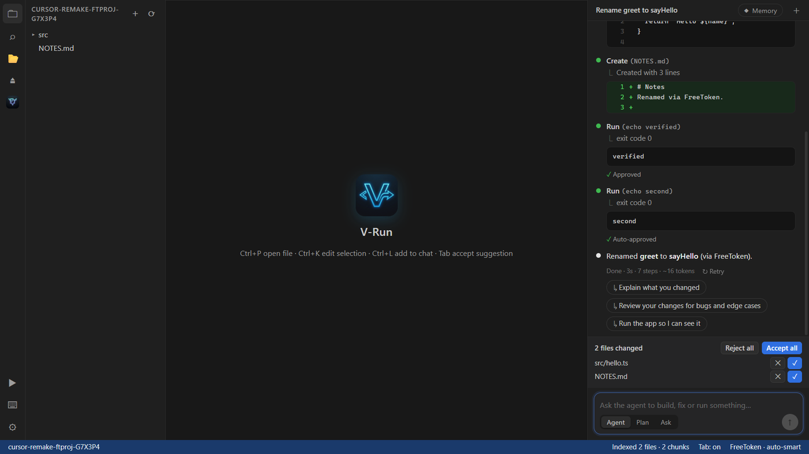
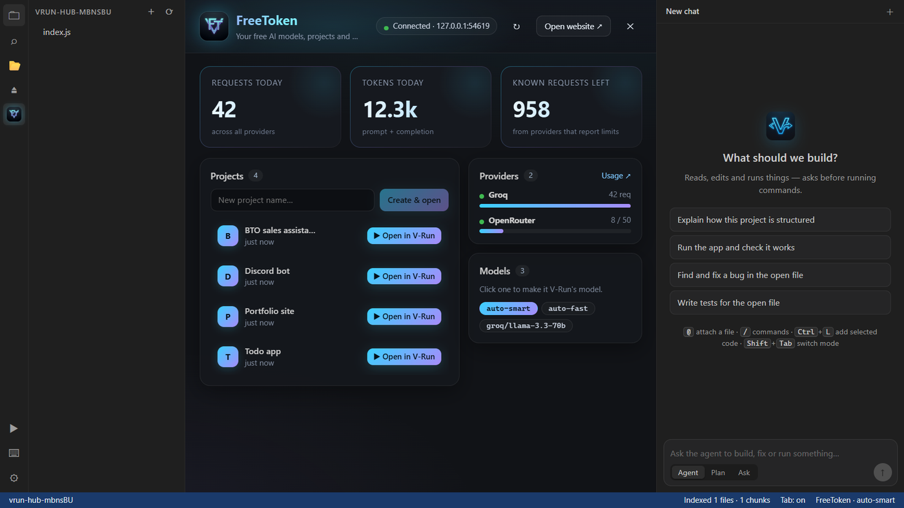
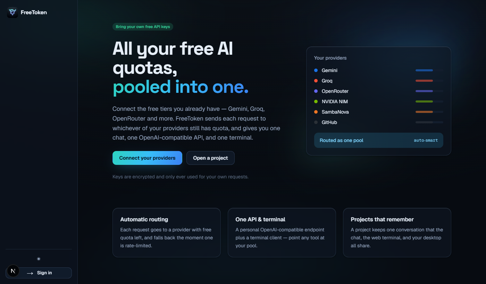
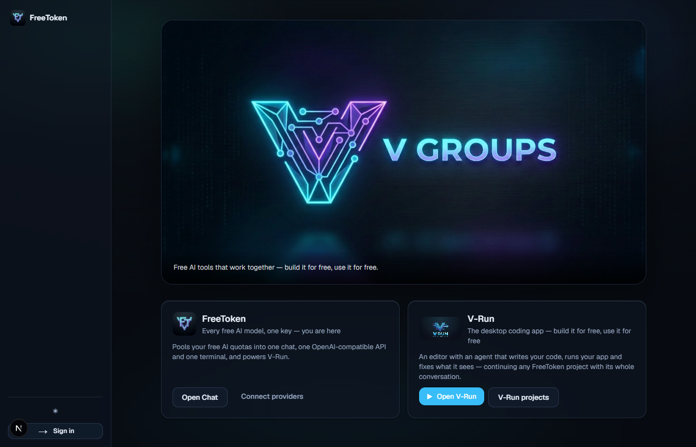
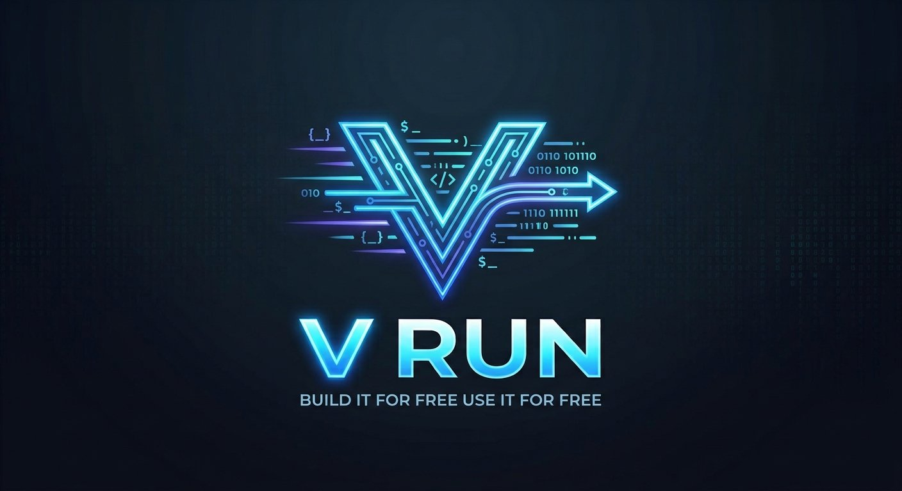

<div align="center">



<h1>FreeToken · free AI tokens for everyone</h1>

<p><strong>Pool every free AI tier — Gemini, Groq, OpenRouter, NVIDIA, Cloudflare, Cohere, GitHub Models and more — into<br/>one chat, one OpenAI- and Anthropic-compatible API, and V-Run, a desktop AI coding agent with a team of agents. $0, no credit card, self-hosted.</strong></p>

<a href="https://readme-typing-svg.demolab.com">
  
</a>

[](https://github.com/V-Groups-Foundations/freetoken/stargazers)
[](https://github.com/V-Groups-Foundations/freetoken/actions/workflows/ci.yml)


**[Quick start](#-quick-start-one-line) · [Features](#-what-you-get) · [Claude Code & co.](#-claude-code-cursor--cline--on-free-models) · [V-Run](#%EF%B8%8F-v-run--the-free-ai-coding-agent) · [Providers](#-free-providers) · [FAQ](#-faq)**

<sub>A <b>V Groups</b> project · if it saves you money, a ⭐ helps others find it</sub>

</div>

---

## 💡 What is FreeToken?

Every AI company gives away a free tier — Google Gemini, Groq, OpenRouter, NVIDIA NIM, Cloudflare, Cohere, GitHub Models… On its own each one runs out fast. **FreeToken pools them.** Add the free API keys you sign up for (no card needed for most) — or none at all to start — and every request goes to whichever provider still has quota, falling back automatically the moment one is rate-limited.

You get **free AI tokens** through:

- 💬 **A chat app** — like ChatGPT, but running on every free model you have.
- 🔌 **Your own API** — OpenAI-compatible *and* Anthropic-compatible, so Claude Code, Cursor, Cline, Continue, Aider, LangChain or your scripts run on it.
- 🖥️ **V-Run** — a desktop AI code editor (think Cursor / Claude Code) whose agents write code, run your app and fix what they see — alone or as a **team working in parallel**.

Your keys are encrypted and used only for *your* requests. Nothing is shared, nothing is billed.

```
  Kilo · LLM7 (no key) ┐
  Gemini · Groq        ┤                       ┌─► 💬 Chat
  NVIDIA · Cloudflare  ┼──►  FreeToken router  ┼─► 🔌 OpenAI + Anthropic API ─► Claude Code · Cursor · Cline…
  Cohere · GitHub      ┤     (auto-failover)   └─► 🖥️ V-Run agents (solo or a team)
  OpenRouter · Z.ai …  ┘
```

## ⚡ Quick start (one line)

**Windows** (PowerShell):

```powershell
irm https://raw.githubusercontent.com/V-Groups-Foundations/freetoken/master/install.ps1 | iex
```

**macOS / Linux:**

```bash
curl -fsSL https://raw.githubusercontent.com/V-Groups-Foundations/freetoken/master/install.sh | bash
```

That's it. Your browser opens **already signed in** (no account, no password — a private link only your computer has), and **chat works immediately**: Kilo Gateway, LLM7 and a starter model need no key at all.

Then make it faster: on **Connect**, click *Get key* for Gemini or Groq, copy the key on their page, and come back — it's added automatically. OpenRouter is one click. Already have keys? Paste them all at once (or a whole `.env` file) and FreeToken recognises each one.

<details><summary>Prefer to do it by hand?</summary>

You need **Node.js 20.9+**. The database is built in, and it updates itself when you pull new code.

```bash
git clone https://github.com/V-Groups-Foundations/freetoken.git
cd freetoken
npm install
npm run dev       # sets itself up, then opens http://localhost:3000 signed in
```
</details>

**Want the desktop coding agent too?**

```bash
npm run desktop   # builds and opens V-Run — it starts FreeToken and connects itself
```

## 🤖 Claude Code, Cursor & Cline — on free models

FreeToken speaks the **OpenAI** Chat Completions API (`/api/v1/chat/completions`), the OpenAI **Responses** API (`/api/v1/responses`, what the Codex CLI uses) and the **Anthropic** API (`/api/v1/messages`) — all with streaming and tool use — so the AI tools you already use run on your free pool.

**One click:** on the **API** page, press *Connect* next to a tool and FreeToken sets it up on your computer:

| Tool | After one click |
|---|---|
| Claude Code | type `claude-free` — Claude Code on your free models (your normal `claude` is untouched) |
| Codex (latest) | type `codex-free` (a separate `freetoken` profile; your default is untouched) |
| Aider | type `aider-free` |
| Continue | pick **FreeToken (auto-smart)** in its model list |
| Cursor · Cline | *Get a key* gives you the base URL, a key and the model to paste |

Each tool gets its own key you can revoke, and *Disconnect* removes exactly what FreeToken added. From a terminal:

```bash
freetoken run claude              # Claude Code, on free models (in this folder: npm run claude)
freetoken run aider --model openai/auto-smart
freetoken setup cursor            # copy-paste setup for Cursor, Cline, Continue, Codex, OpenCode…
```

Claude model names map to FreeToken automatically (`haiku` → `auto-fast`, everything else → `auto-smart`).

## 📸 Screenshots

| V-Run Team mode: agents in parallel, one owner per file, a reviewer at the end | V-Run skills: built in, from GitHub, or learned |
|---|---|
|  |  |
| **Paste a screenshot, drop a file — the right skill loads itself** | **Usage: % used, what's left, when it resets** |
|  |  |
| **V-Run: the agent edits, runs and verifies** | **V-Run: your FreeToken hub** |
|  |  |
| **FreeToken on the web** | **The V Groups family** |
|  |  |

## 🚀 What you get

| | |
|---|---|
| 🔀 **Smart routing** | `auto-smart` / `auto-fast` pick a provider with quota left; instant fallback on rate limits; images go to a model that can see. |
| 🔌 **OpenAI-compatible API** | `/api/v1/chat/completions`, streaming and tool calls — works with any OpenAI SDK or tool. |
| 🤖 **Anthropic-compatible API** | `/api/v1/messages` — Claude Code and Anthropic SDKs on free models. |
| 🧠 **Responses API** | `/api/v1/responses` — the latest Codex CLI and OpenAI SDK `responses.create` on free models. |
| 🧩 **One-click tool setup** | Claude Code, Codex, Aider, Continue set up for you; Cursor and Cline in two pastes. |
| 💬 **Chat** | Markdown, images, voice in/out, attachments, across all your providers. |
| 📁 **Projects** | One conversation per project — plan it in chat, then **Continue in V-Run** with the whole context. |
| 🎨 **Image studio** | Keyless image generation (Flux / Turbo) plus an optional Gemini engine. |
| 📄 **Chat with docs** | Text, PDFs and images (OCR) with cited answers (RAG). |
| 🌐 **Web** | Keyless URL reader and Tavily search, in chat and in the agents. |
| 🛠️ **Tools** | Extract · translate · summarize · classify. |
| 📊 **Usage dashboard** | Claude-style meters: % used, what's left and when each limit resets (per day / month / minute), plus one **overall bar** for all your daily limits. Live numbers from the providers are marked apart from published limits; estimated token counts are marked **≈**. |
| 🖥️ **Terminal agent** | `freetoken` CLI: a coding agent in your terminal; you approve each step. |

## 🖥️ V-Run — the free AI coding agent



`desktop/` is **V-Run**, a desktop AI code editor (Electron + Monaco) — a free alternative to Cursor and Claude Code that runs on your FreeToken models (or Claude, with your own key).

- **Agent, Team, Plan and Ask modes** — the agent reads, searches, edits files and runs commands; Plan proposes a plan you approve first; Ask only reads.
- **Team mode: agents working in parallel** — a supervisor splits a bigger job between up to 4 agents running at once, each owning its own files. A file coordinator keeps them apart: an agent can't edit a file another one owns, everyone who read a file is told when another agent changes it, and nobody edits a stale copy. Questions go up to the supervisor. When the agents finish, a **reviewer agent** checks their work automatically (reads every change, runs the tests, never edits) and either approves or lists fixes for the owning agents — then reviews again. The **Team panel** shows every agent live, and all their changes land in one review.
- **Skills, picked automatically** — 24 built-in skills (frontend UI, backend APIs, web animation, landing pages, dashboards, React, Next.js, databases, auth, testing, debugging, refactoring, accessibility, performance, SEO, Python, Docker, git, API integrations, charts, SVG, browser games, three.js, HTML video). V-Run matches each request to the right skill and the chat says *“Using skill: …”*. **Install more from any GitHub repo** (any folder with a `SKILL.md`, e.g. `anthropics/skills`), or teach it new ones in the chat.
- **HTML videos → MP4** — the agent makes animated videos as HTML pages and exports them to real MP4 files, frame-perfect (time is stepped frame by frame, so heavy pages still come out smooth).
- **Websites that don't all look the same** — each project gets its own design direction (editorial, Swiss grid, neo-brutalist, luxury minimal, retro, dark terminal… 12 in all), and the agent is told to avoid the generic “AI website” look.
- **Paste and drop anything** — Ctrl+V a screenshot or drag files and images onto the chat; they're saved in the project and shared with the AI (images as images, text files with their contents).
- **Accept all or step by step** — chosen once per task, so it never nags you mid-job.
- **Runs your app** — starts your web app inside the editor, *sees* the page and its console errors, and fixes them. One-click **Fix with AI** on crashes.
- **Diffs, rewind and retry** — every edit shown as a diff; rewind any message to undo its file changes.
- **Memory with `V.md`** — like `CLAUDE.md`: `/init` writes your project's memory, `# note` adds to it, and the agent saves lasting facts (how to run and test the project, your preferences) — not logs of what it just did.
- **Visible reasoning, follow-up suggestions, @file mentions, Tab completion and Ctrl+K inline edits.**
- **FreeToken built in** — sign in with one click; the FreeToken hub shows your projects, models and usage (with the overall limit bar); **Continue in V-Run** from any FreeToken project, and its turns are saved back to the web chat.

## 🔑 Free providers

| Provider | Free tier |
|---|---|
| **Kilo Gateway · LLM7** | **work with no key at all** — used out of the box (Nemotron Ultra 550B, DeepSeek V4 Flash, Codestral…); a free key raises the limits |
| Google Gemini · Groq · NVIDIA NIM · Cohere · GitHub Models · SambaNova | free, no card |
| Cloudflare Workers AI | 10,000 neurons/day free (GPT-OSS 120B, GLM 4.7 Flash) |
| Z.ai | GLM Flash models free |
| OpenRouter · Requesty | free models (OpenRouter 50/day, Requesty 200/day) |
| Built-in starter | a keyless fallback so chat always works (set `FREETOKEN_STARTER=off` to turn keyless providers off) |

Optional tools: Tavily (web search) · DeepL (translation) · Jina (embeddings) · OCR.space (scanned files) · ElevenLabs / Google TTS (voices).

## ❓ FAQ

<details><summary><b>Is it really free?</b></summary>

Yes. FreeToken is open source (MIT) and runs on your machine. It uses the free tiers that AI providers already offer; you sign up for them yourself (most need no credit card). FreeToken just makes them work together — no subscription, no hidden costs. Kilo Gateway, LLM7 and a starter model (via [Pollinations](https://pollinations.ai)) work without any key so you can try everything first; they're shared and rate-limited, so add your own free keys for real use.
</details>

<details><summary><b>Where do the "free tokens" come from?</b></summary>

From your own free accounts with each provider (and the keyless free gateways). FreeToken doesn't resell or share anyone's quota — it routes *your* requests across *your* free tiers so you rarely hit a limit.
</details>

<details><summary><b>Can I use it with Claude Code, Cursor, Cline or LangChain?</b></summary>

Yes. On the **API** page, *Connect* sets up Claude Code, Codex, Aider and Continue for you; for Cursor and Cline, *Get a key* gives you the three values to paste. Or use `http://localhost:3000/api/v1` as an OpenAI base URL (or `http://localhost:3000/api` as an Anthropic base URL) with model `auto-smart`. Note: Cursor calls models from its own servers, so it needs FreeToken on a public address rather than localhost.
</details>

<details><summary><b>Are the usage numbers real?</b></summary>

Request counts are counted from every request FreeToken makes. Token counts come from the providers (FreeToken asks every provider to report them); when one doesn't, the number is estimated and shown with **≈**. “Requests left” comes live from the providers' own rate-limit headers where they send them; published limits are shown separately, and providers that only limit per minute (like NVIDIA) say so instead of showing a made-up daily number.
</details>

<details><summary><b>How does Team mode stop two agents editing the same file?</b></summary>

Every file belongs to one agent at a time — the one the supervisor assigned it to, or the first to change it. Another agent's edit to it is refused, and that agent is told to ask the supervisor, who can reassign the file. When an agent changes a file, every other agent that had read it is told who changed it and how, and can't edit it again until it has re-read the new version.
</details>

<details><summary><b>What are skills, and how do I add one?</b></summary>

A skill is know-how in a `SKILL.md` file (the same format Claude uses). V-Run ships 24 and picks the right one for each request automatically. To add more, open **Skills** in V-Run's chat and paste a GitHub repo (`owner/repo` or a link) — every folder with a `SKILL.md` becomes a skill, active straight away. A repo without skills is learned from its README. You can also say “learn this as a skill: …” in the chat.
</details>

<details><summary><b>Are my API keys safe?</b></summary>

They're encrypted at rest with your own `VAULT_MASTER_KEY` (generated on first start) and only ever sent to the provider they belong to. Signing in on your own computer uses a random link that changes every start and is readable only on your machine (like Jupyter's token); set `FREETOKEN_LOCAL_LOGIN=off` if you host FreeToken for others.
</details>

<details><summary><b>How is V-Run different from Cursor or Claude Code?</b></summary>

Same idea — an editor with an agent that edits code and runs commands — but it's free, open source, runs on free models through FreeToken, can run and look at your app while it works, and can split a job across a team of agents working in parallel.
</details>

## 🧱 Tech stack

Next.js 16 · React 19 · TypeScript · Drizzle ORM · PGlite (embedded Postgres) · Auth.js v5 · Tailwind v4 · Vitest — and for V-Run: Electron · Monaco · Vite · WebCodecs (video export) · Playwright (end-to-end tests).

## 🤝 Contributing

Contributions are very welcome — see [CONTRIBUTING.md](CONTRIBUTING.md). Good first steps: add a free provider, write a skill for `desktop/skills/`, improve the docs, or try V-Run and open an issue with what you'd like next.

## ⭐ Support the project

FreeToken is free and will stay free. If it helps you, **star the repo** and share it — that's how other people find free AI tools.

[](https://star-history.com/#V-Groups-Foundations/freetoken&Date)

## 📄 License

MIT — see [LICENSE](LICENSE). Use it, fork it, share it.

<div align="center"><sub>Made by <b>V Groups</b> · build it for free, use it for free.</sub></div>
